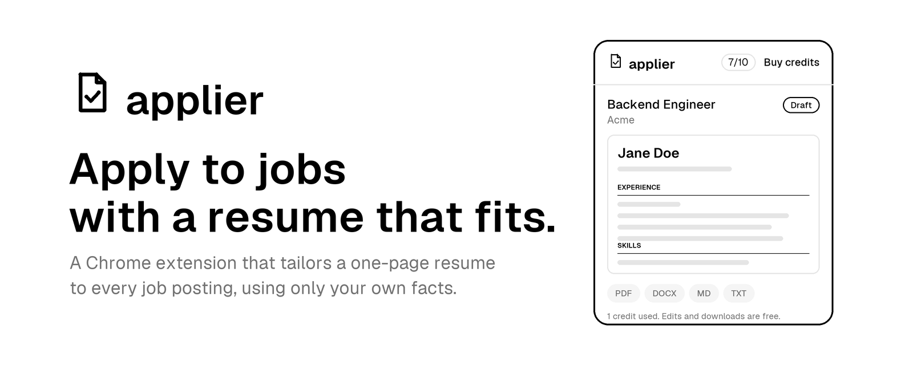

<p align="center">
  
</p>

<p align="center">
  <b>Open a job posting. Get a one-page resume written for that exact role, in seconds.</b><br>
  <sub>A Chrome extension that only ever uses the facts in your own resume.</sub>
</p>

<p align="center">
  <a href="https://applier.site"><b>Get Applier</b></a> &nbsp;·&nbsp;
  <a href="https://applier.site/pricing">Pricing</a> &nbsp;·&nbsp;
  <a href="https://applier.site/faq">FAQ</a> &nbsp;·&nbsp;
  <a href="https://applier.site/blog">Blog</a>
</p>

---

## Why Applier

A resume that is tailored to a job gets read. A generic one gets skipped. But rewriting your resume for every posting is slow, and
most AI tools make it worse by inventing experience you never had.

Applier does the tailoring for you and stays honest. You give it your resume once. From then on, every job you open gets a
version written for that role, built only from what is already true about you.

## What it does

- **Spots the job for you.** Open any job posting and Applier works out that it is one, and pulls out the role and company. If it
  guesses wrong, you can correct it in one click.
- **Writes a tailored resume.** It matches your experience to what the employer asks for, reorders and rewords it, and keeps the
  language truthful. No invented employers, dates, degrees or numbers.
- **Always one page.** Your resume is fitted to a single page. If something has to go, the least important items are removed first,
  and you are told exactly what.
- **Yours to shape.** Ask for a change in plain words, edit any line by hand, remove or rearrange whole sections, and undo anything.
  Edits are unlimited.
- **Download anywhere.** PDF, DOCX, Markdown or plain text.

## How it works

| | |
|---|---|
| **1. Sign in** | One click with Google. |
| **2. Add your resume** | Upload a PDF, DOCX, Markdown or text file. This is the only source of facts. |
| **3. Open a job posting** | Applier detects it automatically and reads the description. |
| **4. Generate, adjust, download** | Review the tailored resume, change what you like, and download it in the format you need. |

## Simple pricing

- **10 free resumes** to start. No card needed.
- After that, **$0.10 per tailored resume**, with a **$3 minimum** purchase. No subscription.
- A credit is spent when a resume is generated. **Editing, undoing and downloading it are free and unlimited.** If generation fails,
  nothing is charged.
- Promo codes are accepted at checkout.

Prices are set on the server and shown live at [applier.site/pricing](https://applier.site/pricing).

## Your data

- While the side panel is open, Applier reads the text of the tab you are on to check whether it is a job posting. That text is
  **not saved** unless you generate a resume for the page.
- Applier **never applies for you**. It prepares a resume; you send it.
- Each browser is linked to one account, using a random ID of which only a hash is stored.
- Full details: [applier.site/privacy](https://applier.site/privacy).

## Built with

Chrome Manifest V3 side panel (React, Tailwind) · FastAPI · DSPy · PostgreSQL · Stripe · Resend · Next.js. The AI model is a setting,
not a dependency: any LiteLLM-supported provider works.

## Run it yourself

The extension, API and website are all in this repo.

```
backend/     FastAPI API, DSPy modules, migrations, tests
extension/   Chrome extension (side panel and full-tab editor)
web/         Marketing website (Next.js)
assets/      Logo and README banner
docs/        Development and deployment guide
```

Setup, configuration (AI model, pricing, Stripe, email, Google sign-in) and deployment are in
**[docs/DEVELOPMENT.md](docs/DEVELOPMENT.md)**.

---

<p align="center">
  <br>
  <sub>Built by <a href="https://github.com/FireBird-Technologies">FireBird Technologies</a></sub>
</p>
